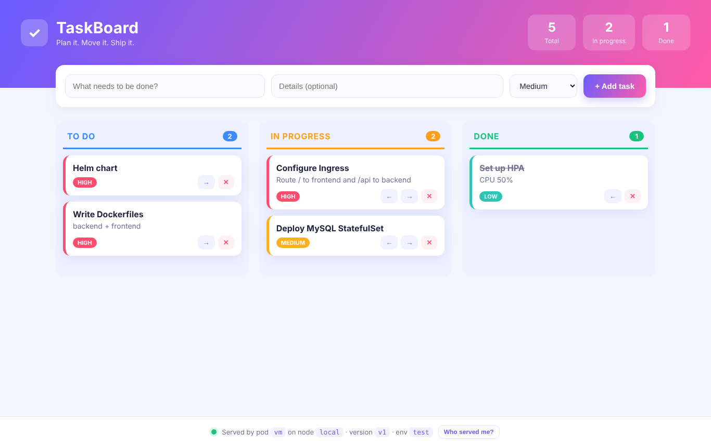

# TaskBoard: Kubernetes Capstone Project

A bright 3-tier task manager (kanban board) used to practise Kubernetes Modules 1-13 end to end.



## 📘 Step-by-step guide

**Full guided steps (build, deploy, harden, Helm, AWS): [GUIDE.md](GUIDE.md)**

| Phase | What you do | Guide section |
| --- | --- | --- |
| 1 | Build and push Docker images, test with Docker Compose | [Phase 1](GUIDE.md#3-phase-1-build-and-push-the-docker-images) |
| 2 | Deploy on Kind with plain YAML | [Phase 2](GUIDE.md#4-phase-2-deploy-on-kind-with-plain-yaml) |
| 3 | Probes, scheduling, DaemonSet, HPA, VPA, PDB | [Phase 3](GUIDE.md#5-phase-3-production-hardening) |
| 4 | Rolling update to v2 and rollback | [Phase 4](GUIDE.md#6-phase-4-rolling-update-to-v2-and-rollback) |
| 5 | Package as a Helm chart | [Phase 5](GUIDE.md#7-phase-5-package-everything-as-a-helm-chart) |
| 6 | Production deploy on kubeadm (AWS) | [Phase 6](GUIDE.md#8-phase-6-production-deploy-on-the-kubeadm-aws-cluster) |
| - | Troubleshooting, cleanup, assignments | [Section 9](GUIDE.md#9-troubleshooting-cleanup-and-assignments) |

```
Browser ──> Frontend (nginx, :8080) ──/api──> Backend (Flask, :5000) ──> MySQL (StatefulSet, :3306)
```

## Folder layout

```
taskboard/
├── app/
│   ├── backend/            Flask API + Dockerfile (multi-stage, non-root)
│   ├── frontend/           HTML/CSS/JS + nginx template + Dockerfile (non-root)
│   └── docker-compose.yaml Run everything locally with Docker
├── k8s/                    Plain YAML, applied step by step (Phases 2-3)
│   ├── 00-namespace.yaml
│   ├── 01-configmap.yaml
│   ├── 02-secret.yaml
│   ├── 03-mysql.yaml       Headless Service + StatefulSet + PVC + node affinity
│   ├── 04-backend.yaml     Deployment + ClusterIP Service, probes, anti-affinity
│   ├── 05-frontend.yaml    Deployment + NodePort Service (30080)
│   ├── 06-ingress.yaml     Traefik Ingress: / -> frontend, /api -> backend
│   ├── 07-hpa.yaml         Backend autoscaling 2-6 pods at 50% CPU
│   ├── 08-pdb.yaml         Keep 1 backend pod during drains
│   ├── 09-vpa.yaml         MySQL size recommendations (Off mode)
│   └── 10-log-agent.yaml   DaemonSet on every node
└── helm/taskboard/         The same app as one Helm chart (Phase 5-6)
    ├── values.yaml
    ├── values-dev.yaml     Kind
    └── values-prod.yaml    kubeadm on AWS
```

## Quick start

```bash
# 0. Get the code
git clone https://github.com/Satyams-git/TaskBoard-Kanban-K8s.git taskboard && cd taskboard

# 1. Build and push images (replace with your Docker Hub user)
export DOCKER_USER=yourname
docker build -t $DOCKER_USER/taskboard-backend:v1 app/backend
docker build -t $DOCKER_USER/taskboard-frontend:v1 app/frontend
docker push $DOCKER_USER/taskboard-backend:v1
docker push $DOCKER_USER/taskboard-frontend:v1

# 2. Put your user into the YAML files
sed -i "s/YOUR_DOCKERHUB_USER/$DOCKER_USER/g" k8s/*.yaml

# 3. Label one worker for MySQL, then deploy
kubectl label $(kubectl get nodes -o name -l '!node-role.kubernetes.io/control-plane' | head -1) role=db
kubectl apply -f k8s/00-namespace.yaml
kubectl apply -f k8s/01-configmap.yaml -f k8s/02-secret.yaml -f k8s/03-mysql.yaml -f k8s/04-backend.yaml -f k8s/05-frontend.yaml
```

For the complete walkthrough with expected outputs, see [GUIDE.md](GUIDE.md).

## API

| Method | Path | Purpose |
| --- | --- | --- |
| GET | /api/health | Liveness probe |
| GET | /api/ready | Readiness probe (checks MySQL) |
| GET | /api/info | Pod, node, version, environment |
| GET / POST | /api/tasks | List / create tasks |
| PUT / DELETE | /api/tasks/{id} | Update / delete a task |
| GET | /api/stress?seconds=N | Burn CPU (HPA demo, max 30 s) |
